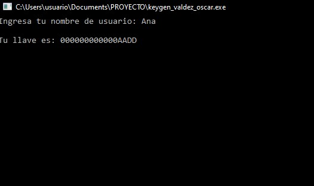
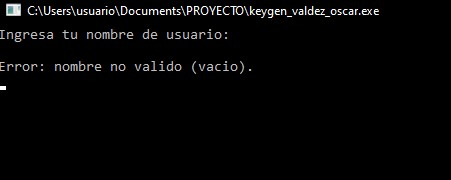

# Proyecto Módulo 2 - Keygen Básico

Proyecto de **Lenguajes de Interfaz (SCC-1014)** desarrollado en ensamblador x86-64.

## Nombre del alumno

**Oscar Sebastian Valdez Barrios**  
**Matrícula:** 23490625

## Descripción del proyecto

El programa solicita un nombre de usuario y genera una llave a partir de sus caracteres. La llave se muestra en la consola en formato hexadecimal de **16 dígitos**, con letras mayúsculas y ceros a la izquierda.

La entrada se realiza con `ReadConsoleA` y la salida con `WriteConsoleA`, funciones de `kernel32.dll`. El programa también valida que el nombre no esté vacío ni supere los 64 caracteres.

## Instrucciones de compilación

Ensamblar con **UASM64**:

```cmd
uasm64 -win64 -c -Fo"keygen_valdez_oscar.obj" "keygen_valdez_oscar.asm"
```

Enlazar con **GoLink** y `kernel32.dll`:

```cmd
GoLink /console /entry main /fo keygen_valdez_oscar.exe keygen_valdez_oscar.obj kernel32.dll
```

Ejecutar:

```cmd
keygen_valdez_oscar.exe
```

## Capturas de pantalla del programa en ejecución

**Ejecución con el nombre `Ana`:**



**Validación de nombre vacío:**




## Explicación del algoritmo de generación de llave

El procedimiento `GenerarLlave` recorre el nombre carácter por carácter, obtiene su valor ASCII con `MOVZX` y lo suma en el registro `RAX` con `ADD`.

Al finalizar, aplica `XOR` con la constante `0ABCDh`. Después, `ConvertirHex` transforma el resultado en una cadena de 16 dígitos hexadecimales utilizando `AND 0Fh` y `SHR RAX, 4`.

Por ejemplo, para el nombre **Ana**:

```text
A = 65, n = 110, a = 97
Suma ASCII = 65 + 110 + 97 = 272 = 0110h
Llave = 0110h XOR ABCDh = AADDh

Tu llave es: 000000000000AADD
```
